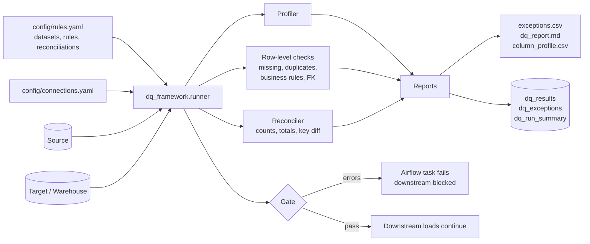

# Automated Data Quality & Reconciliation Framework

A configuration-driven **Python, SQL, and Airflow** framework that profiles incoming datasets, detects **duplicates and missing values**, **reconciles source-to-target records**, validates **business rules**, and produces **exception reporting** so downstream analytics can be trusted.


> **Note:** The demo uses synthetic data in local SQLite databases with deliberately planted defects, so every check can be verified end to end. Swap the connection URLs for Snowflake, Postgres, etc. to run it on a real warehouse.

---

## Problem

Dashboards and models are only as trustworthy as the data under them. Quality problems usually surface late, from a confused stakeholder, rather than at the pipeline gate. This framework turns data-quality expectations into **versioned, testable configuration** that runs on every load, flags the exact records at fault, and blocks bad data from reaching reports.

## What It Does

| Capability | Implementation |
|---|---|
| **Profiling** | Per-column type, null %, distinct count, min/max/mean/std, top value; flags high-null and constant columns |
| **Missing values** | Required-column completeness checks, including blank strings |
| **Duplicates** | Single-column and composite uniqueness rules |
| **Business rules** | Declarative expressions (e.g. `delivered` orders must have a ship date, no negative totals) with `error`/`warn` severity |
| **Referential integrity** | Orphan detection against parent tables (cross-connection supported) |
| **Source-to-target reconciliation** | Row counts, control totals, missing/extra keys, and column-level value mismatches with tolerance |
| **Exception reporting** | Record-level `exceptions.csv`, a Markdown summary, and audit tables persisted to the warehouse |
| **Pipeline gate** | CLI exit code and an Airflow task that fails the DAG on error-severity findings |

## Architecture



## Repository Structure

```
.
├── config/
│   ├── rules.yaml                 # datasets, rules, reconciliations (the "data contract")
│   └── connections.yaml           # SQLAlchemy URLs
├── dq_framework/
│   ├── profiler.py                # column profiling + findings
│   ├── checks.py                  # missing, duplicates, allowed values, business rules, FK
│   ├── reconcile.py               # source-to-target reconciliation
│   ├── reporting.py               # summary, markdown, audit-table persistence
│   └── runner.py                  # orchestration + CLI (exit code 1 on errors)
├── airflow/dags/data_quality_framework_dag.py
├── sql/
│   ├── 01_audit_tables.sql        # audit DDL
│   └── 02_warehouse_native_checks.sql   # same checks pushed down into SQL
├── scripts/seed_demo_db.py        # demo DBs with planted defects
├── tests/test_framework.py
└── docs/extending.md
```

## Quick Start

```bash
git clone https://github.com/<your-username>/data-quality-reconciliation-framework.git
cd data-quality-reconciliation-framework
python -m venv .venv && source .venv/bin/activate
pip install -r requirements.txt

python scripts/seed_demo_db.py      # creates demo/source.db and demo/target.db
python -m dq_framework.runner       # runs all checks, writes reports/
pytest -q
```

The runner exits with code **1** when any error-severity check fails, so it works as a CI or orchestration gate. Use `--no-persist` to skip writing audit tables.

## Example Rule Configuration

```yaml
datasets:
  orders:
    connection: source
    table: orders
    primary_key: [order_id]
    required_columns: [order_id, customer_id, order_date, order_total, status]
    unique: [[order_id]]
    allowed_values:
      status: [pending, shipped, delivered, cancelled]
    business_rules:
      - name: non_negative_total
        expression: "order_total < 0"        # selects the violating rows
        severity: error
    referential:
      - {column: customer_id, ref_connection: source, ref_table: customers, ref_column: customer_id}

reconciliation:
  - name: orders_source_to_warehouse
    source: {connection: source, table: orders}
    target: {connection: target, table: dw_orders}
    key: [order_id]
    row_count: true
    column_sums: [order_total]
    compare_columns: [customer_id, order_total, status]
    tolerance: 0.01
```

## Demo Results

The seeded demo data contains known defects. The framework finds every one of them:

| Planted defect | Detected by | Result |
|---|---|---|
| 12 duplicated order IDs | `duplicates` | 24 rows flagged (each pair) |
| 18 orders with no customer | `missing_values` | 18 |
| 5 orders pointing to a non-existent customer | `referential_integrity` | 5 |
| 9 negative order totals | `rule:non_negative_total` | 9 |
| 7 invalid statuses (`returned`) | `allowed_values` | 7 |
| 11 delivered orders with no ship date | `rule:delivered_requires_ship_date` | 11 |
| 6 orders shipped before they were placed | `rule:ship_before_order` | 6 |
| 15 orders dropped by the load | `recon_missing_in_target` | 15 |
| 1 phantom order in the warehouse | `recon_extra_in_target` | 1 |
| 8 order amounts drifted by +12.50 | `recon_value_mismatch` | 8 |
| 3 large orders (> $10k) | `rule:suspiciously_large_order` | 3 (warning only) |

See a full run in [`reports/sample_summary.md`](reports/sample_summary.md). The row-count difference of 26 on orders is the sum of the 12 duplicate rows the warehouse load removed, the 15 dropped rows, minus the 1 extra row, which is why reconciling counts *and* keys matters.

## Design Decisions

- **Config over code:** rules live in YAML, so analysts can add checks in a pull request without touching Python.
- **A broken rule is loud:** an expression that fails to evaluate becomes an `error` finding rather than silently passing.
- **Null-safe reconciliation:** two nulls count as a match. A naive `!=` comparison reports false mismatches, and there is a regression test for it.
- **Record-level evidence:** every failure lists the offending `record_key`, so the data owner can fix the source rather than guess.
- **Severity levels:** warnings inform without blocking, so the gate stays strict where it matters.

## Airflow Integration

`airflow/dags/data_quality_framework_dag.py` defines `profile_and_check → evaluate_gate`, plus a `notify` task that always runs. Make your load and transform tasks depend on `evaluate_gate` so bad data never reaches downstream tables.

## Limitations & Future Work

- Tables are loaded into pandas, so very large tables should use the pushdown queries in `sql/02_warehouse_native_checks.sql` or a partition filter.
- Anomaly detection on historical `dq_results` trends (e.g. null-rate spikes)
- Slack/email alerting in the `notify` task
- Schema-drift detection between runs

See [`docs/extending.md`](docs/extending.md) for how to add datasets, rules, and reconciliations.

## Author

**Aayushi Parag Shah** · Business Data Analyst
[LinkedIn](https://www.linkedin.com/) · [GitHub](https://github.com/)

## License

MIT
